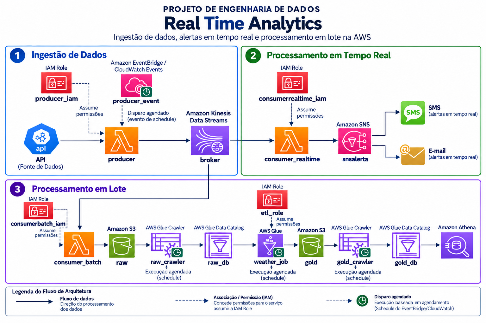
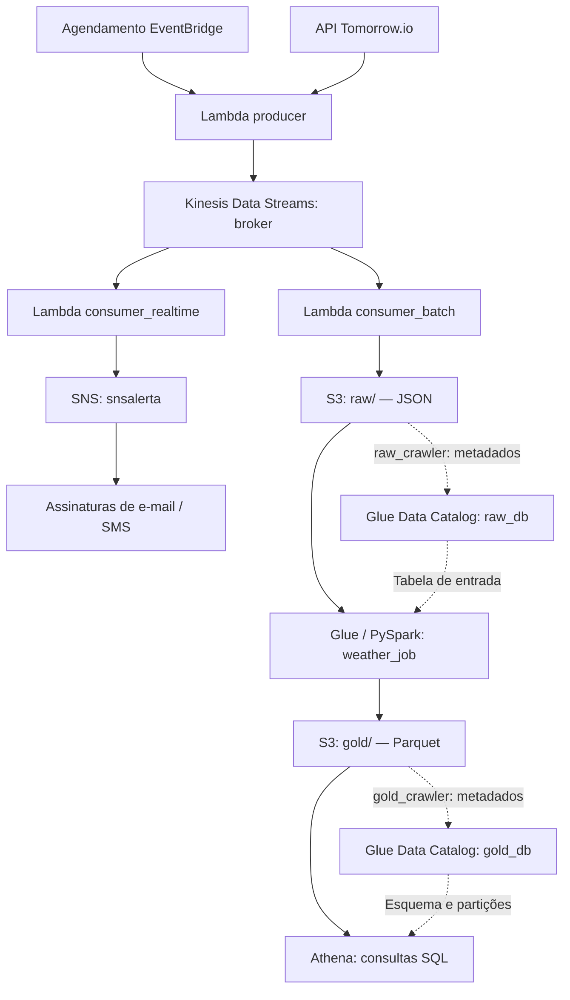

# Real Time Analytics na AWS

### Projeto de Engenharia de Dados

Pipeline de dados meteorológicos que combina processamento em tempo real para alertas e processamento em lote para preparação de dados analíticos. O projeto utiliza Python e serviços AWS para coletar informações da API Tomorrow.io, distribuir eventos pelo Amazon Kinesis e armazenar dados nas camadas Raw e Gold do Amazon S3.

## Objetivo

Explorar, em um projeto de estudo, o caminho dos dados desde uma API externa até o envio de alertas e a organização de um histórico consultável com SQL.

A mesma coleta alimenta dois consumidores independentes: um avalia condições meteorológicas e publica alertas; o outro persiste os eventos para posterior transformação com AWS Glue e PySpark.

## Arquitetura




As setas tracejadas representam catalogação e uso de metadados. Os crawlers descrevem os arquivos no catálogo; os dados permanecem no S3.

O diagrama representa a arquitetura do projeto. Regras de agendamento, assinaturas SNS, permissões IAM, mapeamentos do Kinesis para as Lambdas, crawlers e configuração do Athena dependem da configuração na AWS; não há definição de infraestrutura como código nos arquivos fornecidos.

## Como o pipeline funciona

### 1. Ingestão

A função `producer` consulta o endpoint de clima em tempo real da Tomorrow.io usando uma chave obtida da variável de ambiente `TOMORROW_API_KEY`.

O JSON retornado é publicado no stream `broker` pelo método `put_record`. No código original, a região está definida como `us-east-1`, a localização usa as coordenadas `-29.6846, -51.1419` e os registros utilizam uma chave de partição fixa.

O disparo periódico é configurado externamente. Assim, a atualização depende da frequência de coleta e da disponibilidade da API; não há medição de latência ou garantia de atualização contínua documentada.

### 2. Alertas em tempo real

A função `consumer_realtime` recebe registros do Kinesis, decodifica o conteúdo Base64 e verifica quatro indicadores:

| Indicador no JSON | Variável de ambiente | Padrão no código |
| --- | --- | --- |
| `precipitationProbability` | `PRECIPITATION_PROBABILITY` | `10` |
| `windSpeed` | `WIND_SPEED` | `10` |
| `windGust` | `WIND_GUST` | `10` |
| `rainIntensity` | `RAIN_INTENSITY` | `10` |

Se **qualquer indicador for maior ou igual ao respectivo limite**, a função publica uma mensagem no tópico SNS com o assunto `Alerta Meteorológico`.

Os valores das variáveis são convertidos para inteiros. O valor `10` é apenas o padrão do código, não uma recomendação de limiar meteorológico. Campos ausentes entre esses quatro indicadores recebem `0` na leitura.

O envio por e-mail ou SMS depende das assinaturas e da configuração do tópico. O script publica no SNS; não configura os destinatários. Ele também não implementa supressão de alertas repetidos.

### 3. Persistência na camada Raw

A função `consumer_batch` também consome o stream e grava cada evento como um arquivo JSON no bucket definido por `BUCKET_NAME`.

Padrão de chave dos objetos:

```text
raw/year=<ano>/month=<mes>/day=<dia>/weather_data_<timestamp>.json
```

As partições Raw usam a data UTC do momento da ingestão. Apesar do nome `consumer_batch`, essa Lambda recebe eventos do Kinesis; o processamento analítico em lote acontece posteriormente no Glue.

### 4. Transformação e camada Gold

O script `jobglue.py` consulta as tabelas do banco `raw_db` no Glue Data Catalog e lê os dados catalogados.

Com PySpark, o job:

1. Converte o `DynamicFrame` em `DataFrame`.
2. Transforma campos aninhados do JSON em colunas.
3. Seleciona o horário da observação, indicadores meteorológicos, latitude e longitude.
4. Deriva `year`, `month` e `day` a partir de `data.time`.
5. Grava os dados em Parquet no prefixo `gold/`, particionados por ano, mês e dia.

Entre os campos tratados estão temperatura, sensação térmica, umidade, probabilidade de precipitação, intensidade da chuva, velocidade e rajada do vento, visibilidade e índice UV.

**A data de particionamento da Gold vem da observação meteorológica; a da Raw vem da ingestão.** Elas podem ser diferentes.

O destino S3 está fixo no script original e precisa ser substituído pelo bucket do ambiente. A camada Gold contém dados tabulares preparados para análise; o job não cria agregações de negócio.

### 5. Consulta analítica

Após catalogar o prefixo `gold/` no banco `gold_db`, os arquivos Parquet podem ser consultados pelo Athena. O nome da tabela depende da configuração do crawler.

Exemplo de consulta, substituindo `SUA_TABELA_GOLD` pelo nome real:

```sql
SELECT
    year,
    month,
    day,
    AVG(temperature) AS temperatura_media,
    MAX(windspeed) AS maior_velocidade_vento,
    AVG(humidity) AS umidade_media
FROM gold_db.SUA_TABELA_GOLD
GROUP BY year, month, day
ORDER BY year, month, day;
```

Esta consulta é um exemplo de uso, não um resultado de execução fornecido com o projeto. Confira os nomes das colunas no catálogo antes de executá-la.

## Tecnologias

| Tecnologia | Papel no projeto |
| --- | --- |
| Python, Requests e Boto3 | Consumo da API e interação com os serviços AWS |
| Tomorrow.io | Fonte dos dados meteorológicos |
| AWS Lambda | Coleta e consumo dos eventos |
| Amazon Kinesis Data Streams | Distribuição dos eventos para os consumidores |
| Amazon SNS | Publicação de alertas |
| Amazon S3 | Armazenamento Raw em JSON e Gold em Parquet |
| AWS Glue e PySpark | Transformação dos dados em lote |
| Glue Crawlers e Data Catalog | Descoberta de esquema e catalogação |
| Amazon Athena | Consultas SQL sobre os dados catalogados |
| EventBridge / CloudWatch Events | Agendamento da coleta na arquitetura |
| IAM | Permissões de acesso dos componentes |

## Arquivos do projeto

O material original está organizado em pastas de estudo dentro de `scripts/`:

| Pasta | Arquivo | Conteúdo |
| --- | --- | --- |
| `ConhecendoAPIConsumoDeDados/` | `Tomorrow.ipynb` | Exploração da API Tomorrow.io |
| `Desenvolvendo Pipeline Real Time/` | `lambda_function_producer.zip` | Pacote da Lambda produtora, com código e dependências |
| `Desenvolvendo Pipeline Real Time/` | `consumer_realtime.py` | Avaliação dos limites e publicação de alertas |
| `Desenvolvendo Pipeline Batch/` | `consumer_batch.py` | Persistência dos eventos no S3 |
| `Desenvolvendo Pipeline Batch/` | `jobglue.py` | Transformação de JSON para Parquet |

Para facilitar a leitura no GitHub, extraia também **somente `lambda_function.py`** do pacote do produtor e disponibilize-o ao lado dos demais scripts da pasta de tempo real. Não é necessário versionar as bibliotecas extraídas do pacote.

## Configuração para reprodução

É necessário ter uma conta AWS, uma chave da Tomorrow.io e acesso aos serviços utilizados. O notebook pode ser explorado localmente; as Lambdas e o job Glue dependem de seus respectivos ambientes e recursos na AWS.

### Parâmetros presentes no código

| Componente | Configuração | Onde ajustar |
| --- | --- | --- |
| Produtor | `TOMORROW_API_KEY` | Variável de ambiente da Lambda |
| Produtor | `latitude`, `longitude`, `STREAM_NAME`, `REGION` | Constantes em `lambda_function.py` |
| Consumidor de alertas | Quatro limites da tabela de indicadores | Variáveis de ambiente da Lambda |
| Consumidor de alertas | `SNS_TOPIC_ARN` | Constante em `consumer_realtime.py` |
| Consumidor Raw | `BUCKET_NAME` | Variável de ambiente da Lambda; apenas o nome do bucket |
| Job Glue | `input_database`, `output_path` | Constantes em `jobglue.py` |
| Job Glue | `JOB_NAME` | Argumento utilizado na inicialização do job |

No código original, `SNS_TOPIC_ARN`, `STREAM_NAME` e `output_path` **não são lidos de variáveis de ambiente**. Criar variáveis com esses nomes sem alterar os scripts não muda seus valores.

### Sequência de configuração

1. Criar o bucket S3, o stream Kinesis e o tópico SNS. Configurar e confirmar as assinaturas desejadas.
2. Ajustar os nomes dos recursos, região, destino Gold e ARN do tópico nos scripts.
3. Configurar as roles IAM de cada componente para acessar os recursos necessários e registrar logs.
4. Publicar o produtor com suas dependências e definir `TOMORROW_API_KEY`. O handler do arquivo original é `lambda_function.lambda_handler`.
5. Publicar os dois consumidores e definir suas variáveis. Se os nomes dos arquivos forem mantidos, os handlers são `consumer_realtime.lambda_handler` e `consumer_batch.lambda_handler`.
6. Configurar um mapeamento de origem Kinesis para cada consumidor e o agendamento do produtor.
7. Após a chegada de JSONs ao S3, executar o crawler Raw apontando para `raw/` e verificar o esquema no banco `raw_db`.
8. Configurar e executar o job Glue com `jobglue.py`, usando o catálogo Raw e o destino Gold corretos.
9. Executar o crawler Gold sobre `gold/`, catalogar os dados em `gold_db` e configurar o local de resultados do Athena.
10. Validar uma consulta e, depois, configurar os agendamentos das etapas em lote conforme a dependência entre elas.

A configuração de permissões, empacotamento, recursos e agendamentos é manual nesta versão. Não há um comando único de implantação. A utilização dos serviços e da API pode gerar custos.

## Validação sugerida

- Executar o produtor e conferir a chegada de registros ao Kinesis.
- Verificar os arquivos JSON no prefixo Raw e os logs dos consumidores.
- Usar um evento de teste com um indicador acima do limite para verificar a publicação no SNS.
- Conferir o esquema gerado pelo crawler antes de executar o Glue.
- Verificar a geração de arquivos Parquet e das partições na Gold.
- Consultar uma amostra no Athena e comparar seus valores com o JSON de origem.

Esses passos são um roteiro de validação. Os arquivos fornecidos não incluem uma suíte de testes, medições de desempenho ou evidências de execução ponta a ponta.

## Cuidados antes de publicar

- Usar uma variável de ambiente para a chave da API no notebook e remover saídas salvas que possam conter informações sensíveis.
- Revogar ou rotacionar qualquer chave que tenha sido compartilhada ou incluída em arquivos versionados.
- Substituir referências específicas da conta e do ambiente por exemplos documentados. ARNs e nomes de buckets são configurações, não senhas.
- Não incluir credenciais AWS, arquivos `.env` reais ou pacotes de dependências extraídos no repositório.

## Limitações e próximos passos

- Adicionar timeout, validação do status HTTP e tratamento de respostas inválidas no produtor.
- Validar o esquema dos eventos e tratar falhas por registro nos consumidores.
- Implementar idempotência e controle de duplicação: reprocessamentos podem gerar novos arquivos e alertas repetidos.
- Definir processamento incremental no Glue; o script não configura explicitamente bookmarks nem deduplicação.
- Paginar a listagem de tabelas do Glue, que atualmente usa uma única chamada a `get_tables`.
- Revisar a chave de partição fixa do produtor para cenários com múltiplas localidades e maior volume.
- Parametrizar os recursos que ainda estão fixos no código e automatizar a infraestrutura.
- Acrescentar testes, métricas e evidências de funcionamento.

## Aprendizados

O projeto exercita integração com APIs, processamento de eventos, separação entre fluxos de alertas e análise histórica, armazenamento em camadas, transformação com PySpark e uso de catálogo de dados para consultas SQL.

---

Projeto de estudo em Engenharia de Dados com AWS. Os scripts demonstram a implementação dos componentes; a configuração e a validação do ambiente são etapas adicionais.
